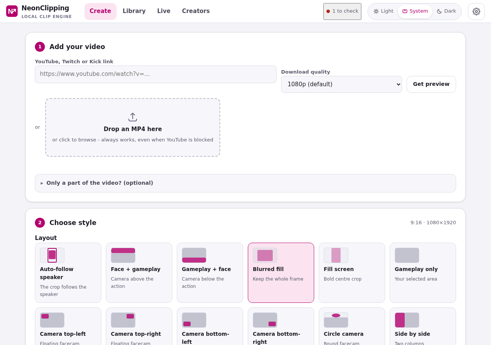
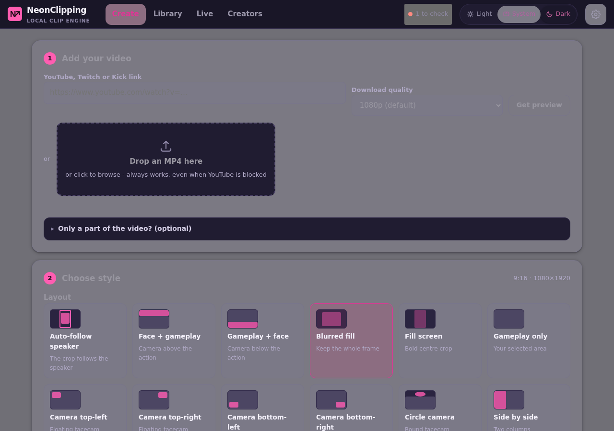

# NeonClipping Plus — long videos → captioned 9:16 clips, 100% free & local

Turn long YouTube / Twitch / Kick videos or your own MP4 files into captioned vertical clips —
completely on your own machine (or a free Google Colab). No API keys, no accounts, no cloud
services, no subscriptions.

**Based on [NeonClipping by Ajay K Meena](https://github.com/iamajmeena/neonclipping)** (MIT).
This fork ("NeonClipping Plus") keeps the MIT licence and adds Colab-first setup, a redesigned
light/dark interface, auto-follow framing, better moment picking and more.

 
*(screenshot placeholders — replace with your own; the UI ships in Light / Dark / System)*

---

## What it does

1. **Download or upload** a video (YouTube, Twitch, Kick replay, or any MP4/MKV/WebM).
2. **Local AI finds the best moments** — movement + audio activity + the transcript, scored by
   a local Ollama model (rubric: first-3-seconds hook, emotional peak, self-contained story,
   payoff, works-alone), plus optional visual review.
3. **Renders 9:16 clips** with your layout (12 layouts incl. **Auto-follow speaker**), caption
   styles (GTA Neon / Impact / Hormozi / MrBeast / Clean, word-by-word + karaoke), Hinglish
   support, hooks, hashtags, watermarks, music beds, SRT/ASS/VTT export.

Everything — speech recognition (faster-whisper), scoring (Ollama), rendering (FFmpeg) — runs
locally. The only network use is downloading the video itself and the open-source models.

## One click on Google Colab (free T4 GPU)

[](https://colab.research.google.com/github/YOUR-USERNAME/neonclipping-plus/blob/main/colab/NeonClipping_Colab.ipynb)

1. Push this repo to your GitHub (see below), download `colab/NeonClipping_Colab.ipynb` and
   upload it to Colab — or fork and use the badge URL.
2. **Runtime → Change runtime type → T4 GPU** (optional but much faster).
3. Edit `REPO_URL` at the top of the first cell to your fork, then run it.
4. At the end it prints a private link like `https://xxxx.trycloudflare.com/?token=…` — open
   it in any browser. Keep it private: it is the access key to that machine.

The notebook installs FFmpeg, Deno, Ollama + `llama3.2:3b`, the caption fonts, starts the app
with remote access (token protected) and opens a free Cloudflare quick tunnel. Every step is
idempotent — re-run the cell any time. Optional cells save finished clips to Google Drive.

> YouTube often blocks Colab's server IPs. When that happens the app says so clearly: upload a
> `cookies.txt` in Settings, or upload the MP4 file instead — that always works.

## Local install (Windows / macOS / Linux)

Requirements: Python 3.10–3.12 and FFmpeg (the app also fetches a portable copy on Windows).

```bash
git clone https://github.com/YOUR-USERNAME/neonclipping-plus.git
cd neonclipping-plus
pip install -r requirements.txt          # + requirements-live.txt for live clipping
python app.py
```

Then open <http://127.0.0.1:8770>. Windows: double-click `NeonClipping-Setup.bat` or run
`run.ps1`. macOS/Linux: `./run.sh`. Optional caption fonts: `python fonts.py --download`.

Check your setup any time: `python scripts/selftest.py` (FFmpeg, yt-dlp, whisper, Ollama, GPU,
NVENC, fonts — each PASS/FAIL with a fix).

### Optional extras

```bash
pip install -r requirements-live.txt     # live clipping (streamlink + pytchat)
pip install -r requirements-gpu.txt      # GPU captions on a PC without a CUDA toolkit
ollama pull llama3.2:3b                  # smarter titles + moment picking (optional)
```

## Environment variables

| Variable | Default | Meaning |
| --- | --- | --- |
| `NEONCLIPPING_REMOTE` | off | `1` = listen on all interfaces, every request needs the token printed at startup (`?token=…`, exchanged for an HttpOnly cookie; constant-time compare, rate limited). |
| `NEONCLIPPING_REMOTE_TOKEN` | random | Pin your own remote-access token. |
| `NEONCLIPPING_LAN` | off | `1` = phone mode: same-Wi-Fi access to the light mobile page with a 6-digit PIN (`/m`). |
| `NEONCLIPPING_PORT` | 8770 | Server port. |
| `NEONCLIPPING_DATA_DIR` | `./data` | Where sources, clips and settings live. |
| `NEONCLIPPING_OLLAMA_MODEL` | auto | Ollama model for scoring (e.g. `qwen2.5:7b`). Settable in Settings too. |
| `NEONCLIPPING_OLLAMA_URL` | `http://127.0.0.1:11434` | Ollama address. |
| `NEONCLIPPING_ASR_MODEL` | by VRAM | Speech model (`tiny`/`base`/`small`/`large-v3-turbo`). Auto: turbo on ≥6 GB free VRAM, base/small on CPU. |
| `NEONCLIPPING_CPU` | off | `1` = never use the GPU. |
| `NEONCLIPPING_ENCODER` | auto | `nvenc` / `amf` / `qsv` / `videotoolbox` / `x264`. |
| `NEONCLIPPING_COOKIES_FILE` | `data/youtube_cookies.txt` | Netscape cookies.txt for yt-dlp. |
| `NEONCLIPPING_COOKIES_BROWSER` | off | Borrow a browser's YouTube login (`chrome`, `firefox`, …). |
| `NEONCLIPPING_NO_AUTOUPDATE` | off | `1` = never pip-update yt-dlp at startup. |
| `NEONCLIPPING_MAX_UPLOAD_GB` | 10 | Upload size cap. |
| `NEONCLIPPING_SOURCE_TTL_DAYS` | 14 | Downloaded sources older than this are deleted automatically (0 = off). Finished clips are never touched. |
| `NEONCLIPPING_UPDATE_REPO` | off | In-app updates: `owner/name`. Off in this fork so it can never overwrite itself with upstream. |
| `NEONCLIPPING_LIVE_AUTO_HOURS` | 3 | Unattended creator-watch sessions stop after this long. |

## Troubleshooting

**YouTube says the server is blocked / "confirm you are not a bot"** — common on Colab, VPNs
and mobile data. Fix, easiest first: (1) upload the MP4 instead (always works); (2) upload a
`cookies.txt` exported from a signed-in browser (Settings → YouTube); (3) another network.
The app already updates yt-dlp daily and retries with five different player clients.

**No GPU / CUDA errors** — everything falls back to CPU automatically (captions get slower).
`python scripts/selftest.py` shows exactly what works. For PC GPU captions without a CUDA
toolkit: `pip install -r requirements-gpu.txt`.

**cuDNN/cuBLAS load errors** — the app detects this and retries on CPU; install
`requirements-gpu.txt` or a CUDA 12 runtime to keep GPU speed.

**Ollama not found** — optional. Without it the app uses activity scoring and transcript-based
hooks. Install from <https://ollama.com>, then `ollama pull llama3.2:3b`.

**Captions look wrong on Linux/Colab** — `python fonts.py --download` bundles Anton +
Montserrat (SIL OFL) so burned captions look the same everywhere.

## Honest limits

- YouTube/Colab blocking is YouTube's decision; cookies.txt or the MP4 path are the workarounds.
- The "viral score" is a heuristic plus a small local model — a ranking aid, not a promise.
- Auto-follow needs a visible face; with no face it falls back to a centre crop.
- Live clipping needs `requirements-live.txt` and only one stream at a time.
- Emoji in captions need an emoji font installed (opt-in setting).
- Cloud AI settings exist in `data/llm.json` for compatibility with upstream, but this fork
  stays 100% local and the cloud option is not exposed in its interface.

## Licence & credits

MIT. © Ajay K Meena (original NeonClipping) — © NeonClipping Plus fork contributors.
See `LICENSE`. Caption fonts: Anton & Montserrat, © Google LLC, SIL OFL 1.1 (`fonts/LICENCE.md`).
Face detection: YuNet (MIT, `models/`). Speech: faster-whisper (MIT). Everything else local.
